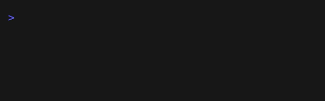
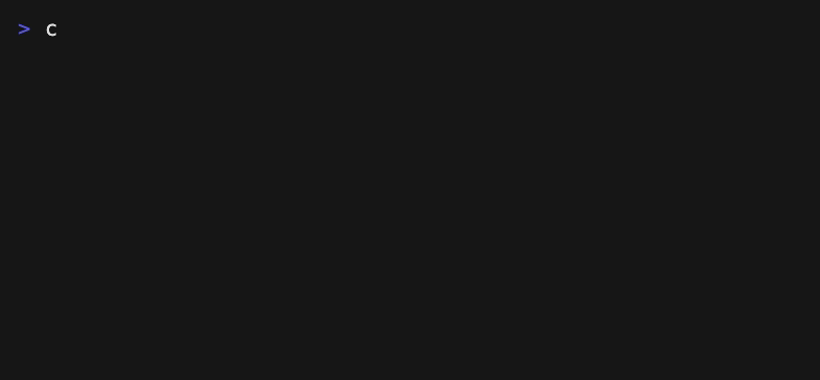
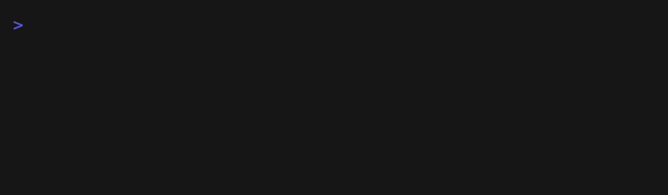
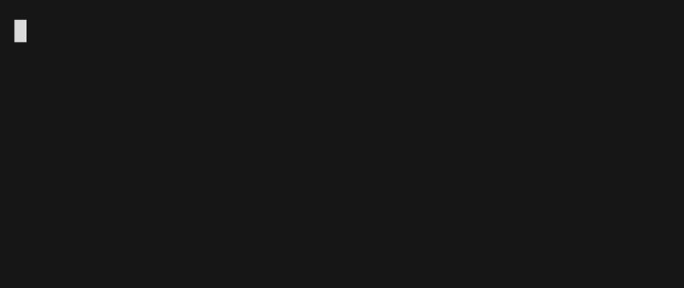
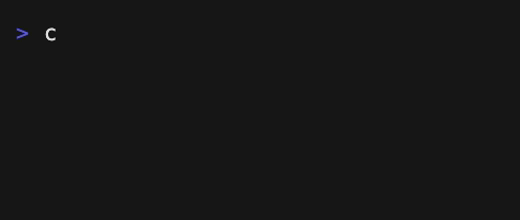
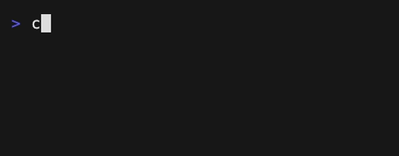

<p align="center">
  <strong>A Crystal port of Charmbracelet's Bubbles TUI components library</strong><br>
  Terminal UI components for building interactive command-line applications with <a href="https://github.com/dsisnero/bubbletea">Bubble Tea</a>
</p>

<p align="center">
  <a href="docs/architecture.md">Architecture</a> &middot;
  <a href="docs/development.md">Development</a> &middot;
  <a href="docs/coding-guidelines.md">Guidelines</a> &middot;
  <a href="docs/testing.md">Testing</a> &middot;
  <a href="docs/pr-workflow.md">PR Workflow</a> &middot;
  <a href="docs/porting-parity.md">Porting Parity</a> &middot;
  <a href="docs/upgrade_guide_v2.md">Upgrading</a>
</p>

---

Self-contained, reusable UI components that compose together to create rich
terminal interfaces. A Crystal port of
<a href="https://github.com/charmbracelet/bubbles">Charmbracelet Bubbles</a>.

Ports **Bubbles v2.2.2** (`charmbracelet/bubbles` @ `0c1a491`), including the
new `tree` bubble, textarea selection/copy, and grapheme-aware editing.

All component GIFs below are recorded from our own Crystal examples with
[VHS](https://github.com/charmbracelet/vhs); see
[docs/assets](docs/assets/README.md) to regenerate them.

---

## Quick Start

1. Add the dependency to your `shard.yml`:

   ```yaml
   dependencies:
     bubbles:
       github: dsisnero/bubbles
   ```

2. Run `shards install`

3. Use in your Crystal + Bubble Tea application:

    ```crystal
    require "bubbles"

    text_input = Bubbles::TextInput.new
    text_area = Bubbles::Textarea.new
    spinner = Bubbles::Spinner.new
    ```

## Components

### Spinner



An animated spinner, useful for indicating an operation is happening. Several
built-in styles are available, and you can define custom frame sequences.

```crystal
s = Bubbles::Spinner.new
s.spinner = Bubbles::Spinner::Dot
```

**Spinner types:** `Line`, `Dot`, `MiniDot`, `Jump`, `Pulse`, `Points`, `Globe`,
`Moon`, `Monkey`, `Meter`, `Hamburger`, `Ellipsis`

### Text Input


A text input field, akin to `<input type="text">` in HTML. Supports unicode,
pasting, in-place scrolling when the value exceeds the width, and many
customization options.

```crystal
ti = Bubbles::TextInput.new
ti.set_width(40)
ti.placeholder = "Enter text..."
ti.prompt = "> "
```

### Text Area


A multi-line text input area, akin to `<textarea />` in HTML. Supports unicode,
pasting, vertical scrolling, dynamic height, selection with clipboard copy, and
grapheme-aware navigation.

```crystal
ta = Bubbles::Textarea.new
ta.set_width(60)
ta.set_height(10)
ta.prompt = "> "
```

### Tree


A hierarchical tree view with keyboard navigation, expand/collapse, and a
scrollable viewport. Ported from the new `tree` bubble in Bubbles v2.2.2.

```crystal
root = Bubbles::Tree::Node.root("~/charm").child(
  "ayman",
  Bubbles::Tree::Node.root("bash").child("zsh", "doom-emacs"),
)
tree = Bubbles::Tree.new(root, 70, 13)
tree.view
```

### Table



A component for displaying and navigating tabular data (columns and rows).
Supports vertical scrolling, column alignment, and customizable borders/styles.

```crystal
t = Bubbles::Table.new(
  Bubbles::Table.with_columns([
    Bubbles::Table::Column.new("Name", 20),
    Bubbles::Table::Column.new("Population", 15),
  ]),
  Bubbles::Table.with_rows([
    ["China", "1.4B"],
    ["India", "1.4B"],
  ]),
)
t.set_width(40)
t.set_height(10)
```

### Progress



A simple, customizable progress meter with optional spring animation via
[Harmonica][harmonica]. Supports solid and gradient fills.

```crystal
p = Bubbles::Progress.new(
  Bubbles::Progress.with_colors(Lipgloss.color("#5A56E0")),
  Bubbles::Progress.with_width(40)
)
p.view_as(0.75)
```

[harmonica]: https://github.com/charmbracelet/harmonica

### Viewport


A viewport for vertically scrolling content. Includes standard pager
keybindings and mouse wheel support. Soft-wrapping and gutter support included.

```crystal
vp = Bubbles::Viewport.new(Bubbles::Viewport.with_width(80), Bubbles::Viewport.with_height(24))
vp.set_content("long content...")
vp.soft_wrap = true
```

### List


A batteries-included component for browsing a set of items. Features
pagination, fuzzy filtering, auto-generated help, an activity spinner, and
status messages. Extrapolated from [Glow][glow].

```crystal
# `items` is an Array(Bubbles::List::Item); `delegate` implements
# Bubbles::List::ItemDelegate.
l = Bubbles::List.new(items, delegate, 40, 20)
```

[glow]: https://github.com/charmbracelet/glow

### File Picker


Navigate the file system to pick files or directories. Supports filtering by
file extension, showing hidden files, and displaying permissions.

```crystal
fp = Bubbles::Filepicker.new
fp.height = 20
fp.show_hidden = true
fp.allowed_types = [".cr", ".md"]
```

### Help



Auto-generated help view from your keybindings. Supports single-line and
multi-line modes, with graceful truncation when the terminal is too narrow.

```crystal
h = Bubbles::Help.new
h.styles = Bubbles::Help.default_dark_styles
h.view(key_map)
```

### Paginator



Handles pagination logic and optionally draws a pagination UI. Supports
"dot-style" (like iOS) and numeric page indicators.

```crystal
p = Bubbles::Paginator.new
p.set_total_pages(5)
p.page = 2
p.type = Bubbles::Paginator::Type::Dots
p.view  # Renders "● ○ ○ ○ ○"
```

### Timer


A simple, flexible component for counting down. The update frequency and output
can be customized as you like.

```crystal
t = Bubbles::Timer.new(30.seconds, Bubbles::Timer.with_interval(100.milliseconds))
```

### Stopwatch



A simple, flexible component for counting up. The update frequency and output
can be customized as you like.

```crystal
sw = Bubbles::Stopwatch.new(Bubbles::Stopwatch.with_interval(100.milliseconds))
```

### Cursor

Terminal cursor manipulation. Controls cursor style, blink behavior, and
position.

```crystal
c = Bubbles::Cursor::Model.new
c.set_mode(Bubbles::Cursor::Mode::Blink)
```

### Key

Non-visual component for managing keybindings. Useful for custom key remapping
and generating help views.

```crystal
Bubbles::Key.new_binding(
  Bubbles::Key.with_keys("k", "up"),
  Bubbles::Key.with_help("↑/k", "move up"),
)
```

## Documentation

| Document | Purpose |
|----------|---------|
| [Architecture](docs/architecture.md) | System design, data flow, package responsibilities |
| [Development](docs/development.md) | Prerequisites, setup, daily workflow |
| [Coding Guidelines](docs/coding-guidelines.md) | Code style, error handling, naming conventions |
| [Testing](docs/testing.md) | Test commands, conventions, patterns |
| [PR Workflow](docs/pr-workflow.md) | Commits, PRs, branch naming, review process |
| [Porting Parity](docs/porting-parity.md) | Upstream source tracking and parity verification |
| [Upgrade Guide v2](docs/upgrade_guide_v2.md) | Migration from Go Bubbles v1 to Crystal v2 |
| [Changelog](CHANGELOG.md) | Release history and notes |

## Contributing

See [Development Guide](docs/development.md) for setup and porting workflow.

## License

MIT (same as the original Go library)

## Acknowledgments

- [Charmbracelet](https://charm.sh/) for the original Go implementation
- The Bubble Tea ecosystem for inspiring terminal UI development
